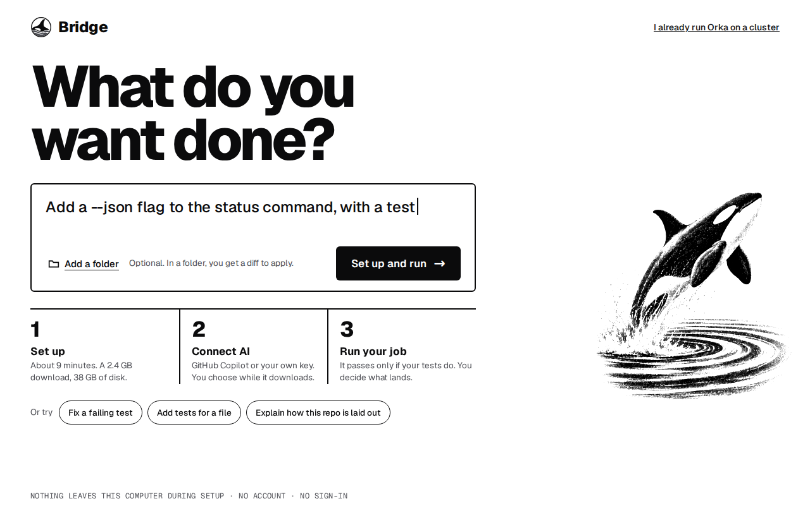
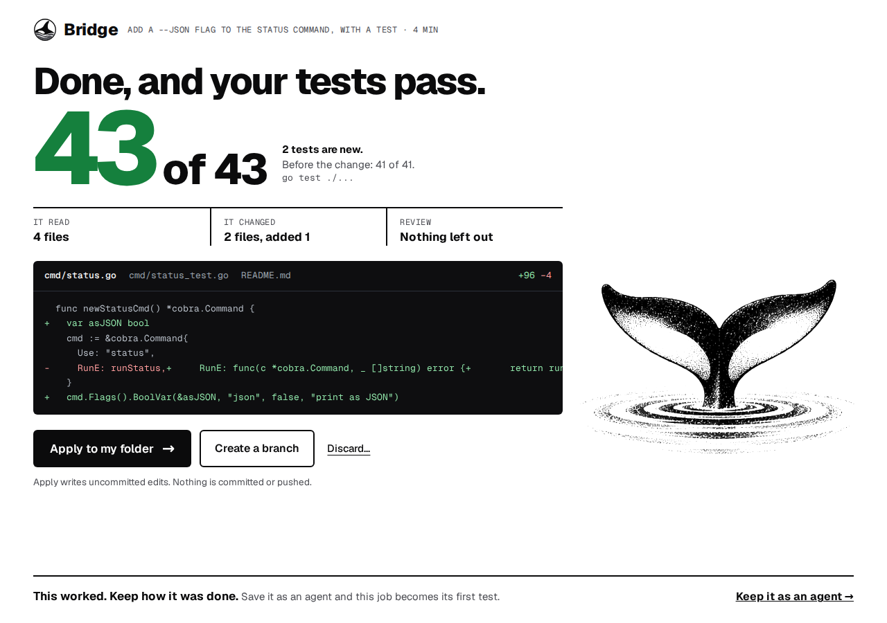
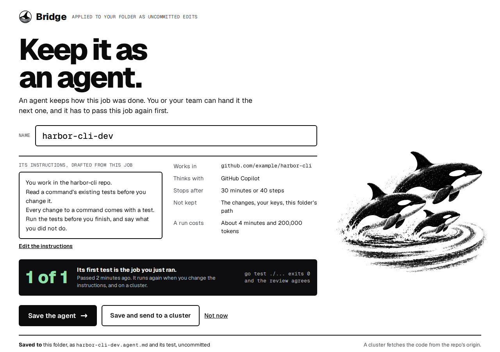
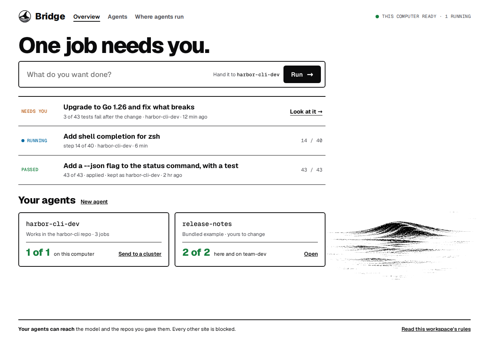

# Job-first screens

These are design mockups for starting Bridge from a job instead of from an agent (#279). They use the Orka website's
look from #284: ink and paper, Geist and Geist Mono, a 6px radius, and colour only for state. Blue means running, green
passed, red failed and amber needs you.

They aren't built yet. Names, repos, numbers, times and token counts on the screens are placeholders. The words are
draft too: today's setup and GitHub sign-in work as [the preview guide](../../preview.md) describes, not as the Start
and Getting ready screens say. The orca drawings
are generated concept art that shows the direction; they'll be redrawn as original artwork based on the Bridge mark
before anything ships.

| Screen | Light | Dark | Issue |
|---|---|---|---|
| Start: one box that asks what you want done, with starter jobs and the three setup steps | [light](light-start.png) | [dark](dark-start.png) | #285 |
| Getting ready: the workspace downloads while you choose the AI | [light](light-ready.png) | [dark](dark-ready.png) | #285 |
| Running: the agent's steps, its limits and the diff so far, with Stop | [light](light-running.png) | [dark](dark-running.png) | #287 |
| Result: the check passed, with Apply, Create a branch and Discard | [light](light-result.png) | [dark](dark-result.png) | #287, #288 |
| Result when the check fails: Apply is off, the failures are listed, and you can ask for a fix | [light](light-result-failed.png) | [dark](dark-result-failed.png) | #288 |
| Keep it as an agent: its instructions, what's kept and its first test | [light](light-save-agent.png) | [dark](dark-save-agent.png) | #289 |
| Overview: what needs you first, then running and finished jobs, then your agents | [light](light-overview.png) | [dark](dark-overview.png) | #286 |

